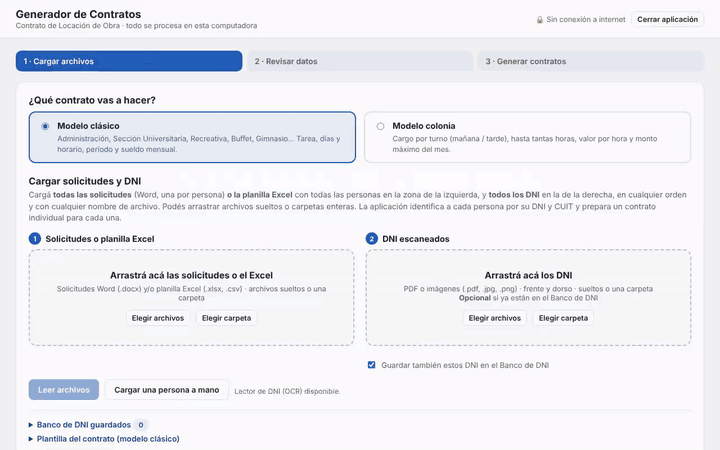
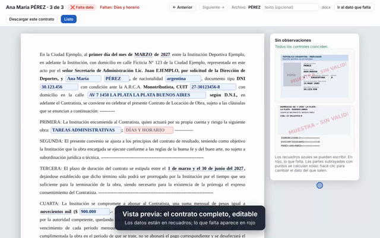
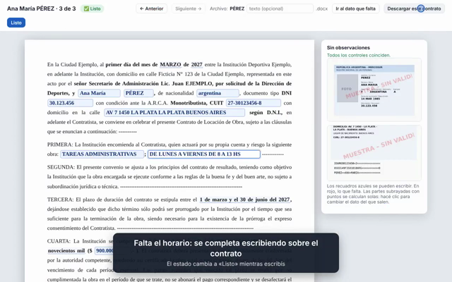
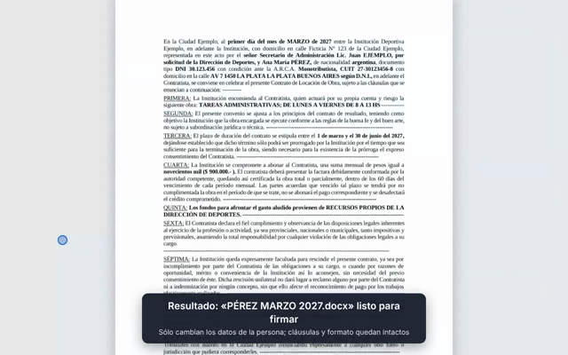

# Generador de Contratos

**Automatiza contratos de locación de obra a partir de Word, Excel y DNI escaneados — 100 % local, sin internet.**

Autor: **Jeremías González Tamame**

*[English version below](#english)*

🎬 [Ver el video completo (MP4, 83 s)](docs/Generador_de_Contratos_demo.mp4)

> La demo usa **datos y DNI ficticios** (marcados «MUESTRA – SIN VALIDEZ») y una institución inventada.

> 🔒 **Este repositorio es una vitrina del proyecto.** El código fuente es privado y puedo mostrarlo en una entrevista o reunión.

---

## El problema

En un área administrativa los contratos se hacían a mano: abrir el modelo en Word, copiar de cada solicitud el nombre, CUIT, tarea, horario, período y sueldo, buscar en el DNI escaneado el número y el domicilio, pasar el sueldo a letras… y repetirlo para cada persona. Era lento y fácil equivocarse.

## La solución

Una aplicación de escritorio para Windows que:

1. **Lee las solicitudes** (Word, una por persona) o una **planilla Excel** con todo el personal.
2. **Lee los DNI escaneados** (PDF o imágenes de impresora) con **OCR**: número, nombre, sexo, nacionalidad y domicilio.
3. **Cruza cada solicitud con su DNI** por CUIT, DNI o nombre, sin mezclar personas. Si no hay coincidencia segura, pide revisión manual: **nunca inventa datos**.
4. **Valida** el CUIT (dígito verificador), el DNI contra el CUIT y la zona de lectura mecánica del DNI (ICAO 9303).
5. **Corrige errores de OCR en domicilios** contra el listado oficial de provincias y localidades argentinas.
6. Muestra una **tabla de revisión editable** y una **vista previa del contrato completo** donde se completa lo que falta.
7. **Genera un .docx por persona conservando exactamente el formato del modelo** (tipografía, negritas, mayúsculas, márgenes) y un ZIP con todos.

### Funciones destacadas

| | |
|---|---|
| Dos modelos de contrato | Clásico (sueldo mensual) y Colonia (horas por turno, valor hora y monto máximo) |
| Banco de DNI | Los DNI se escanean una vez y se reutilizan en contratos futuros |
| Cálculos automáticos | Sueldo en letras, períodos, mes de firma, género del cargo según el DNI |
| Plantillas reutilizables | El modelo de Word se reemplaza por uno nuevo usando marcadores `{{CAMPO}}` |
| Nombre de archivos | `APELLIDO + texto libre` (por ejemplo `PÉREZ MARZO 2027.docx`) |
| Privacidad | Todo se procesa en la computadora; no se envía nada a servicios externos |

## Capturas

| Revisión | Vista previa editable | Contrato generado |
|---|---|---|
|  |  |  |

## Tecnología

- **Python 3.12** portable + servidor HTTP de la biblioteca estándar (solo escucha en `127.0.0.1`)
- **Interfaz** web de una sola página en HTML/JavaScript, sin frameworks
- **python-docx**: reemplazo de texto entre fragmentos («runs») de Word para conservar el formato
- **Tesseract OCR** (español): recorte automático de cada DNI en hojas A4, prueba de rotaciones, lectura de la zona MRZ, procesamiento en paralelo
- **pypdf**, **Pillow**, **openpyxl**
- **difflib**: corrección aproximada de localidades
- Instalador portable para Windows: se prepara una sola vez y luego funciona sin internet, incluso desde un pendrive

## Contacto

¿Te interesa ver el código o una demostración en vivo? Escribime por [LinkedIn](https://www.linkedin.com/in/jerem%C3%ADas-gonz%C3%A1lez-tamame-3b2567357).

## Créditos

- Idea, requisitos y pruebas: Jeremías González Tamame.
- Localidades y departamentos: [Servicio de Normalización de Datos Geográficos de Argentina (Georef)](https://datosgobar.github.io/georef-ar-api/), licencia CC BY 4.0.

## Derechos

© 2026 Jeremías González Tamame. Todos los derechos reservados. El contenido de este repositorio (textos, capturas y video) se publica solo para mostrar el proyecto; no se otorga licencia de uso, copia ni distribución.

---

## English

**Contract Generator** is an offline Windows desktop tool that turns employee request forms (Word or Excel) and scanned national ID cards (PDF/images) into ready-to-sign Word contracts.

> 🔒 **This repository is a project showcase.** The source code is private and available for review during interviews.

- **OCR on scanned Argentine DNI cards** (Tesseract): auto-crops each card from A4 scans, tries rotations, reads the machine-readable zone and validates ICAO 9303 check digits.
- **Safe record matching** by tax ID (CUIT), ID number or name; ambiguous matches are flagged for manual review and data is never made up.
- **Validation** of CUIT check digits and DNI/CUIT consistency; fuzzy correction of OCR typos in addresses against the official list of Argentine localities.
- **Editable review table and live contract preview** for filling in missing fields.
- **Format-preserving Word generation**: text is replaced across Word runs so fonts, bold and capitalization stay identical to the template. One .docx per person plus a ZIP.
- **Privacy by design**: everything runs locally on `127.0.0.1`; no cloud services.

Stack: Python 3.12 (portable), standard-library HTTP server, vanilla HTML/JS, python-docx, Tesseract OCR, pypdf, Pillow, openpyxl.

Author: **Jeremías González Tamame**. © 2026, all rights reserved.

The demo uses fictitious people, sample ID cards marked "MUESTRA – SIN VALIDEZ" and a made-up institution.
